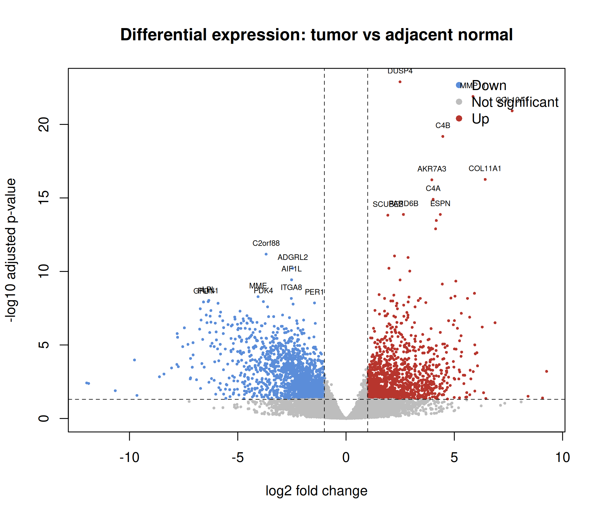
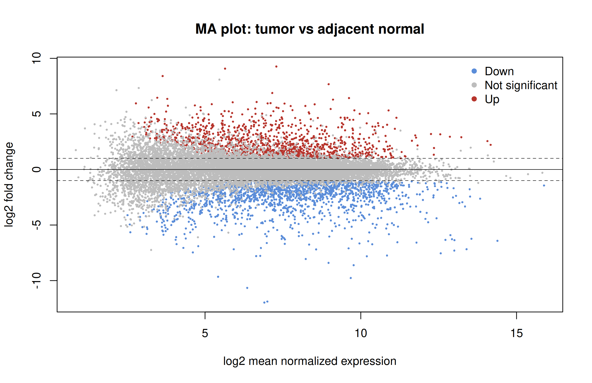
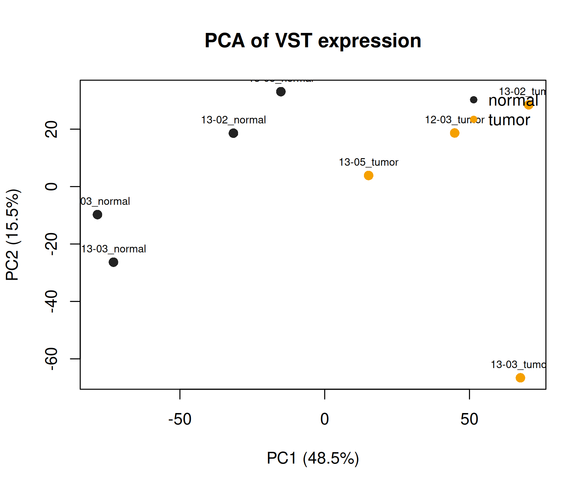
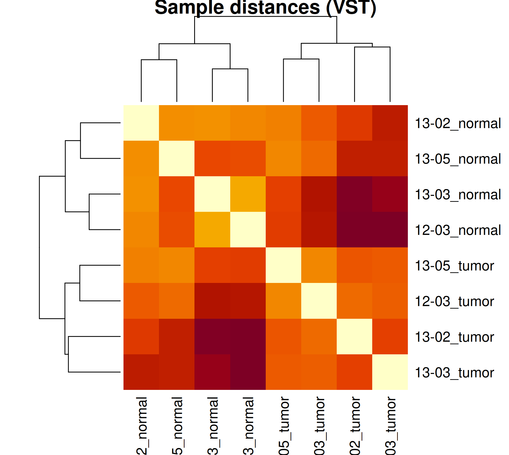
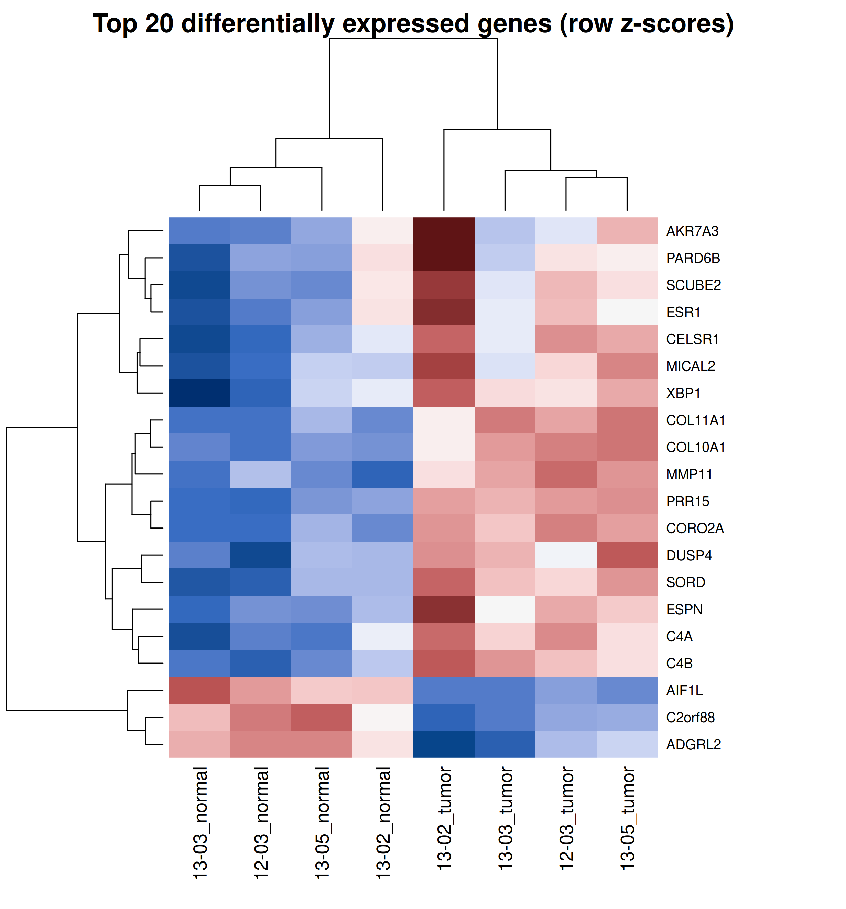
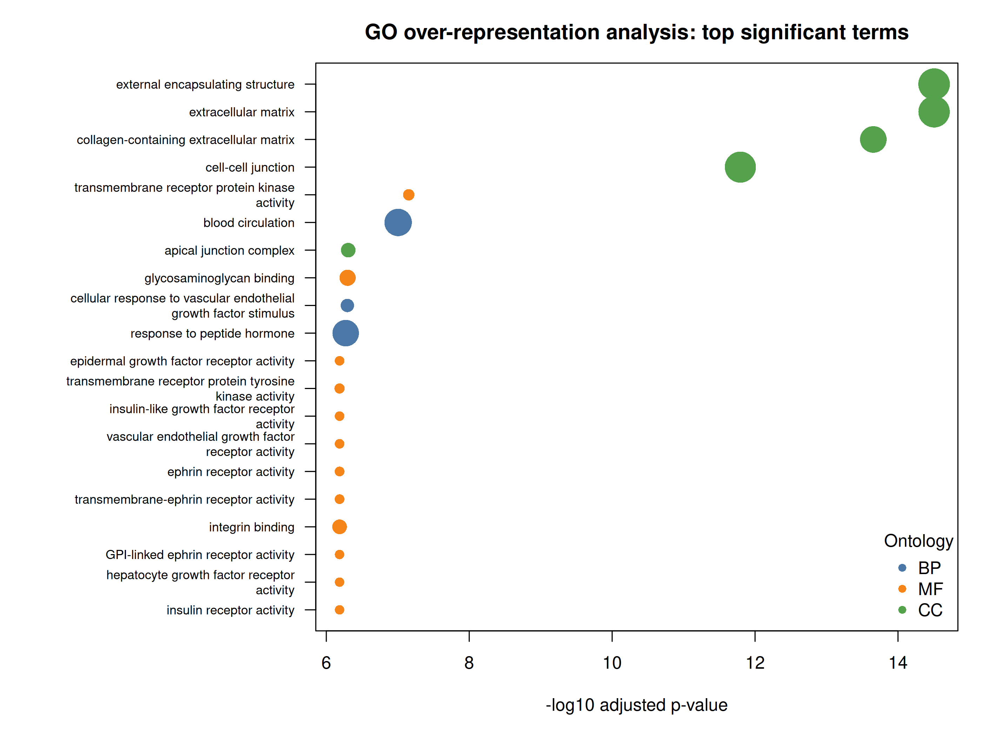

# Abstract

This project reproduces a scaled-down gene-level analysis of the GSE103001
breast cancer RNA-seq dataset. Four patients were selected, providing four
estrogen receptor-positive (ER+) tumors and four matched adjacent
non-malignant tissues. Reads were quality controlled, trimmed, quantified
with Salmon against a decoy-aware Ensembl release 115 GRCh38 reference,
aggregated to the gene level, and analyzed with a paired DESeq2 model. After
filtering, 16,918 genes were tested and 3,274 were differentially expressed at
an adjusted *p*-value below 0.05. Using the additional effect-size criterion
|log2 fold change| >= 1, 1,324 genes were upregulated and 1,633 were
downregulated in tumors. Gene Ontology enrichment highlighted
extracellular-matrix organization, adhesion, junctions, and growth-factor
signaling.

# 1. Objective

The aim was to compare ER+ breast tumors with adjacent non-malignant mammary
tissue from the same patients. The workflow follows the assignment
requirements:

1. retrieve eight RNA-seq samples corresponding to four matched pairs;
2. perform read-level quality control and trimming;
3. quantify transcript abundance using Salmon and a GRCh38 transcriptome;
4. perform paired differential expression analysis;
5. test significant genes for functional enrichment;
6. compare the gene-level results and computational approach with the
   conclusions of the original study.


# 2. Materials and methods

## 2.1 Dataset and paired design

Raw sequencing data were obtained from GEO series **GSE103001**, SRA study
**SRP116023**, associated with BioProject **PRJNA399721**. The pipeline
downloaded and parsed the GEO family SOFT metadata, resolved the selected SRX
experiment accessions to SRR runs through NCBI, and retrieved the corresponding
paired FASTQ URLs from ENA. It then downloaded 16 compressed FASTQ files, two
mates for each of the eight samples.

The source libraries were prepared from total RNA using the TruSeq Stranded
Total RNA kit with Ribo-Zero rRNA depletion and were sequenced as paired-end
reads on an Illumina HiSeq 2000 ([Wenric et al., 2017](https://doi.org/10.1038/s41598-017-17811-2), Methods: “TruSeq Stranded Total RNA by Illumina and next generation sequencing”). The four selected patients were 12-03, 13-02,
13-03, and 13-05. Each contributed one tumor and one adjacent non-malignant
sample:

Patients were selected programmatically from the GEO metadata by identifying
records with both a tumor and a matched adjacent-normal sample.  The next four complete pairs in
patient-identifier order, 12-03, 13-02, 13-03, and 13-05 were used.
Patient 12-02 was excluded because its tumor ENA record contains a mixture of
singleton and paired FASTQ files. The selected sample identifiers, download URLs,
and ENA MD5 checksums are recorded in
`data/RNA-seq/GSE103001/GSE103001_selected_4pairs.tsv`; downloaded FASTQ files
are checked against those checksums.

| Patient | Normal run | Tumor run |
|---|---|---|
| 12-03 | SRR5962199 | SRR5962221 |
| 13-02 | SRR5962200 | SRR5962222 |
| 13-03 | SRR5962201 | SRR5962223 |
| 13-05 | SRR5962202 | SRR5962224 |

The matched structure was retained in the statistical model so that
inter-patient variability was not incorrectly treated as part of the
tumor-versus-normal effect.

## 2.2 Quality control and preprocessing

FastQC was run on all 16 input FASTQ files (two mates for each of the eight
samples) before preprocessing, and the reports were aggregated with MultiQC to
identify recurrent problems across samples.

Reads were then cleaned with fastp 0.23.4 in paired-end mode, using its default
filtering and automatic adapter-trimming behavior for paired reads.  therefore fastp's documented defaults apply: bases with a Phred score
below 15 were considered unqualified, and reads were rejected when:

- More than 40% of their bases were unqualified.
- They contained more than five `N` bases.
- Their cleaned length was below 15 bases.

No fixed head or tail crop was  imposed, because FastQC did not justify discarding the same number of bases
from every library.


FastQC was repeated on all 16 cleaned FASTQ files, and fastp plus post-cleaning
FastQC reports were combined in a second MultiQC report.

The two columns below describe different quantities. **Reads retained** is the
percentage of input reads that remained after fastp had trimmed adapters and
discarded reads failing the filters above. **Post-filter Q30** is then a quality
metric calculated by fastp on those retained reads: it is the percentage of
their bases with Phred quality at least 30 (an estimated error probability of
0.1% or less). It is reported to assess the cleaned data;

| Run | Reads retained after fastp | Q30 among retained reads |
|---|---:|---:|
| SRR5962199 | 95.9% | 80.7% |
| SRR5962200 | 97.4% | 96.5% |
| SRR5962201 | 97.9% | 96.5% |
| SRR5962202 | 99.2% | 89.8% |
| SRR5962221 | 96.4% | 82.9% |
| SRR5962222 | 98.1% | 96.5% |
| SRR5962223 | 97.1% | 96.6% |
| SRR5962224 | 99.3% | 89.7% |

## 2.3 Salmon quantification and gene aggregation

The processed paired-end reads were quantified with Salmon using automatic
library-type detection (`--libType A`) and selective-alignment validation
(`--validateMappings`). Salmon consistently inferred the inward-stranded
reverse (`ISR`) library type for all eight samples, in agreement with the
strand-specific library preparation. For reproducibility, the reference was
fixed to Ensembl release 115. The Salmon index was constructed from the
[Ensembl release 115 GRCh38 cDNA transcriptome](https://ftp.ensembl.org/pub/release-115/fasta/homo_sapiens/cdna/)
concatenated with the matching GRCh38 primary assembly. The 194 genomic
contigs were supplied to Salmon as decoys, producing a decoy-aware index.
This improves assignment specificity by preventing reads with a better genomic
than transcriptomic match from being spuriously quantified as transcripts.
Transcript identifiers were mapped to Ensembl gene identifiers from the
transcriptome FASTA headers. Salmon `quant.sf` files were imported into R with
`tximport` and summarized to Ensembl genes using this transcript-to-gene map.
In other words, `tximport` combines the estimated abundances of all annotated
transcripts belonging to a gene into one gene-level measurement for each
sample. It also calculates the gene's average transcript length in each sample,
weighted by the estimated transcript abundances. This matters because apparent
changes in gene-level counts can otherwise arise when different-length
isoforms are used in the two conditions.

The `tximport` object, including its gene-level counts, abundances, and
abundance-weighted average transcript lengths, was passed directly to
`DESeqDataSetFromTximport`. Thus DESeq2 used the transcript-length information
as sample-specific normalization offsets alongside its usual library-size
normalization; this was part of the analysis, rather than merely a reported
option.

The Salmon mapping rate: the percentage of input fragments assigned to
annotated transcript sequences, ranged from **5.3% to 35.8%**, with a mean of
**22.4%**.

For reproducibility, the workflow records the Salmon and index versions and
index parameters.

| Run | Salmon mapping rate |
|---|---:|
| SRR5962199 | 5.3% |
| SRR5962200 | 24.2% |
| SRR5962201 | 35.8% |
| SRR5962202 | 20.2% |
| SRR5962221 | 8.9% |
| SRR5962222 | 26.5% |
| SRR5962223 | 26.8% |
| SRR5962224 | 31.4% |

This relatively low mapping rate is an important limitation. The original
libraries were generated from ribosomal-RNA-depleted total RNA, so reads from
intronic, intergenic, unannotated, or residual non-coding sequence cannot be
quantified as annotated transcripts by this workflow. Genomic decoys improve
the specificity of the transcript estimates but are not themselves quantified.
Explicitly accounting for intronic and intergenic reads would require a
suitable genome-alignment workflow or a deliberately expanded reference.

## 2.4 Differential expression analysis

Genes were retained when they had at least 10 counts in at least two samples.
DESeq2 was run using:

```text
design = ~ patient + condition
contrast = tumor versus normal
```

The normal samples were used as the reference condition. DESeq2 adjusted the
gene-level Wald-test *p*-values with the Benjamini-Hochberg (BH) procedure,
which controls the false discovery rate. DESeq2's default independent
filtering was applied before multiple-testing correction, using mean
normalized expression to remove genes with insufficient power; such genes
would have `padj = NA`. In this analysis, all 16,918 genes that passed the
explicit count prefilter received a finite adjusted *p*-value, so independent
filtering did not remove any additional genes. BH-adjusted *p*-values below
0.05 were considered significant. For plot classification and effect-size
summaries, a second threshold of |log2 fold change| >= 1 was used; this
fold-change threshold was not part of the *p*-value adjustment.

Variance-stabilized expression values were calculated with DESeq2 using
`vst(dds, blind = FALSE)`. PCA was computed across all 16,918 genes retained
after count filtering. The same VST matrix was used for sample clustering and
the heatmap; the heatmap displays row-wise z-scores for the 20 genes with the
smallest adjusted *p*-values.

## 2.5 Functional enrichment

GO over-representation analysis was performed on all 3,274 DESeq2 genes with
adjusted *p* < 0.05. Upregulated and downregulated genes were analyzed together,
and the |log2 fold change| >= 1 criterion used for effect-size summaries and
plot classification was not applied to the enrichment input. The tested-gene
background was restricted to the 16,918 genes present in the differential
expression results. Ensembl version suffixes were removed before analysis, and
the identifiers were supplied to `enrichGO` with `keyType = "ENSEMBL"` using
`org.Hs.eg.db`. Because annotation coverage differs by ontology, the effective
background contained 14,455 genes for Biological Process, 14,989 for Molecular
Function, and 15,173 for Cellular Component. These three ontologies were tested
using hypergeometric over-representation tests. The resulting term-level *p*-values were adjusted
with the Benjamini-Hochberg procedure. Because BP, MF, and CC were analyzed in
three separate `enrichGO` calls, BH correction was performed independently
within each ontology rather than once over the combined table. Terms with
BH-adjusted *p* < 0.05 were considered significant.

## 2.6 Software environment

The analysis was run in the project Docker environment based on Bioconductor
release 3.21. The resolved analysis versions were Python 3.12.3, R 4.5.2,
Salmon 1.10.2, fastp 0.23.4, FastQC 0.12.1, MultiQC 1.35, DESeq2 1.48.2,
tximport 1.36.1, clusterProfiler 4.16.0, and org.Hs.eg.db 3.21.0. The current
container recipe additionally pins optparse 1.7.5 for command-line parsing.
The recipe is provided in `Dockerfile` and verifies the principal analysis-tool
versions during the image build. Because the base-image tag and Ubuntu and some
supporting R packages are not locked to immutable artifacts, this verification
detects dependency drift but does not guarantee an identical rebuild indefinitely.

# 3. Results

## 3.1 Differential expression

After count filtering, **16,918 genes** were included in DESeq2. A total of
**3,274 genes** had adjusted *p* < 0.05. Among these, **2,957 genes** also had
|log2 fold change| >= 1:

- 1,324 upregulated in tumor;
- 1,633 downregulated in tumor.

The large number of detected genes indicates a strong expression difference
between tumor and adjacent tissue. However, with only four pairs, effect
estimates and the number of discoveries remain sensitive to individual
patients, tissue composition, and the quantification limitations described
above.

Selected strongly upregulated genes included **MMP11**, **ESR1**, **GALNT7**,
**COL11A1**, **CA12**, **COL10A1**, **MKI67**, and **SCUBE2**. MMP11 and the
collagen genes are consistent with extracellular-matrix and tumor-stroma
remodeling, while ESR1, CA12, and SCUBE2 are compatible with the ER+ phenotype.

Selected strongly downregulated genes included **TNS1**, **ACSL1**, **CAVIN1**,
**PDK4**, **ALDH2**, **SLC16A7**, **AQP1**, **ANGPT1**, and **VIM**.
Several of these genes are associated with metabolism, vascular or stromal
components, and normal mammary/adipose tissue. Their lower abundance in tumor
samples may therefore reflect both cancer-cell regulation and changes in
cellular composition.



Red points are upregulated and blue points are downregulated in tumor. Grey
points do not pass both the statistical and effect-size thresholds.



Significant genes are distributed across a broad range of mean expression
values. The asymmetry toward negative fold changes is consistent with the
larger number of downregulated genes.

## 3.2 Sample structure and expression heatmap

The PCA of variance-stabilized expression separated all tumor samples from
all adjacent normal samples along PC1, which accounted for 48.5% of the total
variance. PC2 accounted for a further 15.5% and primarily captured
within-condition heterogeneity.



The sample-distance matrix provides a complementary view of the same VST
data. Distances vary within both conditions, but the global structure is
consistent with the strong condition effect visible in the PCA and in the
differential-expression results.



Hierarchical clustering of the top 20 differentially expressed genes separated
the four tumor samples from the four adjacent non-malignant samples. The
top-ranked set included **C4B**, **COL10A1**, **MMP11**, **COL11A1**,
**DUSP4**, **AKR7A3**, and **CELSR1**.



Values are row-wise z-scores of variance-stabilized counts. Genes and samples
were hierarchically clustered using Euclidean distance and complete linkage;
the corresponding dendrograms are shown at the left and top. The upper color
bar identifies tumor and normal samples.

## 3.3 Gene Ontology enrichment

The enrichment analysis tested 7,792 GO terms and identified **784 significant
terms** at adjusted *p* < 0.05. The strongest results involved extracellular
matrix, adhesion, epithelial junctions, hormone responses, and receptor
signaling.

| GO term | GO identifier | Overlap | Fold enrichment | Adjusted *p* |
|---|---|---:|---:|---:|
| External encapsulating structure | GO:0030312 | 175 | 1.84 | 3.12 x 10^-15 |
| Extracellular matrix | GO:0031012 | 174 | 1.83 | 3.12 x 10^-15 |
| Collagen-containing extracellular matrix | GO:0062023 | 142 | 1.92 | 2.21 x 10^-14 |
| Cell-cell junction | GO:0005911 | 172 | 1.72 | 1.61 x 10^-12 |
| Transmembrane receptor protein kinase activity | GO:0019199 | 40 | 2.73 | 7.02 x 10^-8 |
| Blood circulation | GO:0008015 | 147 | 1.66 | 9.88 x 10^-8 |
| Cellular response to VEGF stimulus | GO:0035924 | 53 | 2.31 | 5.07 x 10^-7 |
| Response to peptide hormone | GO:0043434 | 141 | 1.63 | 5.35 x 10^-7 |

These functions are biologically plausible for breast cancer.
Extracellular-matrix and collagen remodeling can reflect tumor-stroma
reorganization, while altered adhesion, tight junctions, integrin binding,
hormone responses, and growth-factor signaling are relevant to epithelial
tumor behavior. The enrichment analysis was performed on a combined
significant-gene list, so it does not distinguish pathways driven specifically
by upregulated versus downregulated genes.



# 4. Comparison with the original study

Wenric et al. ([2017](https://doi.org/10.1038/s41598-017-17811-2),
Results: “RNA-Seq Validation”) reported tumor downregulation of **ADAMTS9**
and its antisense transcript ADAMTS9-AS2, illustrated by RT-qPCR. In the present
gene-level analysis ADAMTS9 was also downregulated (log2 fold change = -1.85,
BH-adjusted *p* = 0.0022; see the complete DEG table). This is a directional
agreement for one coding gene, not an independent validation: the analyses
use samples from the same study, and we did not test the corresponding
antisense transcript.

The authors also compared their RNA-seq results with the independent
GSE65216 microarray dataset: among genes significant in both datasets, 76.6%
changed in the same direction, and 870 of 1,026 gene sets enriched in their
RNA-seq analysis were also enriched in the microarray analysis. These are the
paper's cross-dataset results, not replication rates calculated here. Their
gene-set enrichment analysis is not directly comparable to our GO
over-representation test, which combines significant genes of both directions.
We did not calculate a genome-wide DEG or pathway overlap with the paper.

The paper's principal aim was to study natural antisense transcripts and their
relationships with protein-coding transcripts. Our broader gene-level GO
results therefore do not reproduce its ncNAT-specific conclusions. Differences
in sample number, reference and quantification further limit direct comparison.

# 5. Effect of the modern computational workflow

Several differences can cause the results to diverge from the original
STAR + HTSeq + GRCh37 analysis:

- **Reference assembly and annotation.** GRCh38 has improved sequence,
  corrected regions, alternate loci, and updated gene/transcript definitions.
  Ensembl release 115 also contains transcripts and gene models unavailable
  in the older GRCh37 annotation.
- **Quantification algorithm.** Salmon estimates transcript abundance using
  selective alignment with mapping validation and resolves multi-mapping
  reads differently from genome alignment followed by HTSeq counting.
- **Transcript-to-gene aggregation.** `tximport` summarizes Salmon estimates
  to genes and supplies effective-length information to DESeq2. Salmon assigns
  ambiguous transcript evidence probabilistically, whereas HTSeq commonly
  discards or handles ambiguous genomic overlaps according to a counting mode.
- **Decoy-aware transcript quantification.** The current index contains genomic
  decoys, which improves the specificity of transcript assignment, but it still
  cannot quantify intronic or intergenic RNA as genes. This is particularly
  relevant for ribo-depleted total RNA and contributes to the low mapping rates
  discussed in Section 2.3.
- **Sample number.** Only four of the original matched pairs were analyzed.
  This reduces statistical power and makes the result more sensitive to
  patient-specific effects.
- **Analysis scope.** The current workflow is gene-level and not
  strand-specific at the ncNAT/protein-coding pair level.

Consequently, exact agreement in DEG identities, fold changes, or pathway
results should not be expected. Agreement at the level of broad tumor biology
is a more appropriate comparison.

# 6. Limitations and possible improvements

The principal limitations are:

1. only four matched pairs were used;
2. Salmon mapping rates were low and variable;
3. cellular composition was not modeled;
4. no fold-change shrinkage was applied before ranking or visualization;
5. GO enrichment combined upregulated and downregulated genes;
6. the analysis did not reproduce strand-specific ncNAT quantification.

A stronger follow-up would use all available matched pairs, verify the library
strandedness, apply `lfcShrink`, and perform separate enrichment for
upregulated and downregulated genes or a ranked-list method such as GSEA.

# 7. Conclusion

The paired DESeq2 analysis detected a strong gene-expression difference
between ER+ breast tumors and adjacent non-malignant tissue. The top genes and
GO terms indicate changes in extracellular-matrix organization, adhesion,
epithelial junctions, hormone responses, metabolism, and signaling. These
results support the broad conclusion that breast tumors undergo extensive
transcriptional remodeling, while the small sample size and low mapping rate
require cautious interpretation. The workflow satisfies the assignment's
gene-level objective but should not be considered a direct reproduction of
the original paper's ncNAT-specific analysis.

# 8. Reproducibility and deliverables

The complete analysis pipeline and the scripts used for data acquisition,
quality control, Salmon quantification, DESeq2 analysis, visualization, and GO
enrichment are available in the repository. The following commands must be run
from the `BSBProject` repository root:

```bash
make docker-build
make analysis
```

`make analysis` runs the complete Part 1 workflow in order: `download-data`,
`qc-raw`, `trim`, `qc-trimmed`, `quantify`, `dea`, and `enrichment`. These stages
build the selected-pair metadata table, download the reads, perform QC before
and after fastp cleaning, quantify the cleaned reads, run the paired analysis,
and generate the differential-expression and GO-enrichment outputs. `make dea`
performs DEA input preparation, paired DESeq2 analysis, and plotting together.
The figures are regenerated on every `make dea` invocation. Likewise, `make
enrichment` regenerates the filtered table, summary, and dot plot every time.

The individual stages can also be run from the repository root:

```bash
make download-data   # metadata, FASTQ files, and reference sequences
make qc-raw          # raw-read FastQC and MultiQC
make trim            # paired-end fastp cleaning
make qc-trimmed      # post-cleaning FastQC and MultiQC
make quantify        # Salmon index, if needed, and quantification
make dea             # tximport inputs, DESeq2, and plots
make enrichment      # GO enrichment and derived outputs
```

The workflow reuses existing outputs when possible. In particular, Salmon skips
an existing sample output directory, and existing DESeq2 and GO results can be
reused without checking whether the inputs or analysis settings have changed.
Therefore, regenerating figures does not necessarily mean that the statistical
analysis was rerun. Before changing inputs or parameters, preserve the existing
outputs and explicitly arrange a fresh run of the affected stages.

The principal deliverables requested by the assignment are:

- short report: `report/part1/report.md`;
- scripts: `main.py`, the Python workflow modules, and the R scripts under
  `RNA_seq/DifferentialExpression/scripts` and `RNA_seq/Enrichment/scripts`;
- raw and post-cleaning QC reports under `data/RNA-seq/GSE103001/qc`;
- complete DEG table: `data/RNA-seq/GSE103001/de/results/deseq2_all_genes.csv`;
- significant DEG table:
  `data/RNA-seq/GSE103001/de/results/deseq2_significant_genes_padj_0.05.csv`;
- enrichment results:
  `data/RNA-seq/GSE103001/enrichment/go_overrepresentation_significant.csv`;
- main figures: the volcano plot, MA plot, PCA, sample-distance heatmap, and
  top-gene heatmap under `data/RNA-seq/GSE103001/de/results`, plus the GO dotplot under
  `data/RNA-seq/GSE103001/enrichment`.

# References

1. Wenric S, et al. *Transcriptome-wide analysis of natural antisense
   transcripts shows their potential role in breast cancer*. Scientific
   Reports. 2017;7:17452. [doi:10.1038/s41598-017-17811-2](https://doi.org/10.1038/s41598-017-17811-2).
2. Patro R, Duggal G, Love MI, Irizarry RA, Kingsford C. *Salmon provides fast
   and bias-aware quantification of transcript expression*. Nature Methods.
   2017;14:417-419.
3. Love MI, Huber W, Anders S. *Moderated estimation of fold change and
   dispersion for RNA-seq data with DESeq2*. Genome Biology. 2014;15:550.
4. OpenGene. *fastp documentation: quality and length filtering defaults*.
   [GitHub](https://github.com/OpenGene/fastp#filtering).
